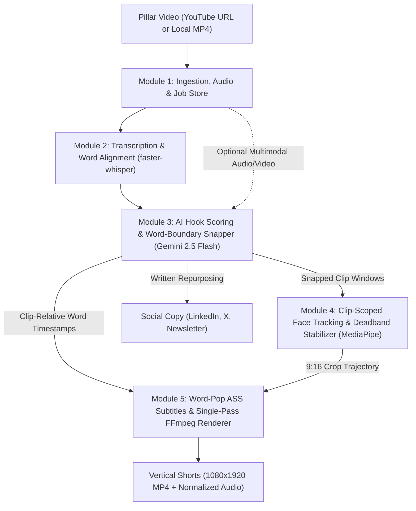

# PillarPrism 💎

> **Transform one long-form pillar video into a full spectrum of high-engagement vertical shorts, social threads, and newsletters.**

PillarPrism is an open-source, local-first digital content repurposing platform. It utilizes Google Gemini (via free-tier API) for multimodal intelligence and reasoning, combined with local tools (`faster-whisper`, `FFmpeg`, and `MediaPipe`) for high-speed, zero-cost video processing and dynamic subtitle animation.

---

## 🌟 Key Features

* **Zero-Cost Operation:** Leverages Google Gemini's free-tier API for AI reasoning and local open-source models for audio/video processing.
* **Multimodal Hook & Clip Detection:** Analyzes full episodes to find high-retention 30–60s segments with compelling hooks.
* **Smart Face Tracking & Re-framing:** Automatically tracks active speakers using computer vision to dynamically crop 16:9 widescreen footage into 9:16 vertical shorts.
* **Animated Karaoke Subtitles:** Generates styled word-by-word highlighted captions burned with FFmpeg.
* **Multi-Channel Text Generation:** Automatically generates LinkedIn carousels, X/Twitter threads, and SEO newsletter summaries from the same pillar asset.

---

## 🏗️ Architecture Overview



---

## 📦 Modular System Design

For a full breakdown of milestones, technical specifications, and delivery phases, see the [Implementation Plan](IMPLEMENTATION_PLAN.md).

1. **Module 1: Ingestion & Media Pipeline** (`yt-dlp`, FFmpeg 16kHz audio extraction, persistent job state manifest)
2. **Module 2: Transcription & Word-Level Alignment** (`faster-whisper` with VAD, millisecond timestamping)
3. **Module 3: Gemini 2.5 Flash Intelligence & Boundary Snapper** (Hook scoring, exact word-boundary snapping, social copy generation)
4. **Module 4: Computer Vision & Smart Re-framing** (Clip-scoped MediaPipe active speaker tracking, deadband + scene-cut stabilization)
5. **Module 5: Dynamic Subtitle & Single-Pass Render Engine** (Word-pop `.ass` captions, bundled fonts, single-pass FFmpeg crop + burn + `loudnorm`)
6. **Module 6: Unified API, Web Dashboard & CLI** (FastAPI backend + React/Vite/Tailwind UI + headless CLI)

---

## 🚀 Quick Start

### Prerequisites
* **Python 3.10+**
* **FFmpeg** installed and added to your system PATH
* **Google Gemini API Key** (Free from [Google AI Studio](https://aistudio.google.com/))

### Setup
```bash
# Clone the repository
git clone https://github.com/mdriyadmr968/PillarPrism.git
cd PillarPrism

# Create a virtual environment
python -m venv venv
.\venv\Scripts\activate

# Install dependencies (once backend requirements are configured)
pip install -r requirements.txt
```

---

## 📄 License
MIT License. Free and open source for everyone.
