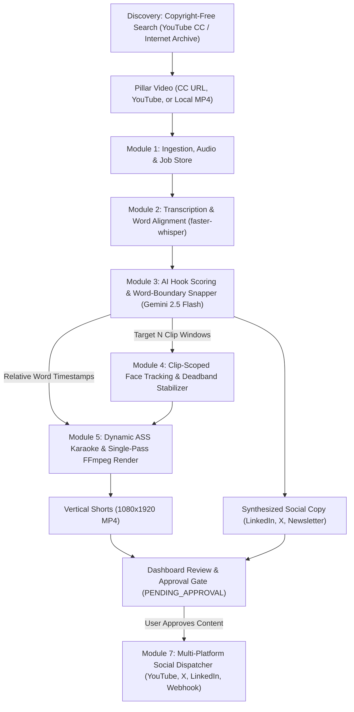

# PillarPrism 💎

> **Transform one long-form pillar video into a full spectrum of high-engagement vertical shorts, social threads, and newsletters.**

PillarPrism is an open-source, local-first digital content repurposing platform. It utilizes Google Gemini (via free-tier API) for multimodal intelligence and reasoning, combined with local tools (`faster-whisper`, `FFmpeg`, and `MediaPipe`) for high-speed, zero-cost video processing and dynamic subtitle animation.

---

## 🌟 Key Features

* **Zero-Cost Operation:** Leverages Google Gemini 2.5 Flash free-tier API for AI reasoning and local tools (`faster-whisper`, `FFmpeg`, and OpenCV) for high-speed, zero-cost video processing.
* **🔍 Copyright-Free Video Discovery:** Search YouTube Creative Commons and Internet Archive for CC-BY and Public Domain long-form videos with automated license attribution tracking.
* **🎯 Configurable Clip Generation:** Specify exactly how many repurpose shorts to generate (1 to 10 clips per episode).
* **Multimodal Hook & Clip Detection:** Analyzes episodes to find high-retention 30–75s segments with compelling opening hooks.
* **Smart Face Tracking & Re-framing:** Automatically tracks active speakers using computer vision with deadband stabilization to dynamically crop 16:9 widescreen footage into 9:16 vertical shorts.
* **Animated Karaoke Subtitles:** Generates styled word-by-word highlighted captions burned in a single FFmpeg pass.
* **Multi-Channel Text Generation:** Automatically generates LinkedIn posts, X/Twitter threads, and newsletter summaries with CC-BY source attribution.
* **✅ Dashboard Approval & Social Dispatcher:** Review and edit generated clips and copy in the web dashboard, approve selections, and publish directly to YouTube Shorts, X (Twitter), and LinkedIn with one click.

---

## 🏗️ Architecture Overview



---

## 📦 Modular System Design

For a full breakdown of milestones, technical specifications, and delivery phases, see the [Implementation Plan](IMPLEMENTATION_PLAN.md).

1. **Module 1: Ingestion & Media Pipeline** (`yt-dlp`, FFmpeg 16kHz audio extraction, persistent job state manifest)
2. **Module 2: Transcription & Word-Level Alignment** (`faster-whisper` with VAD, millisecond timestamping)
3. **Module 3: Gemini 2.5 Flash Intelligence & Boundary Snapper** (Hook scoring, exact word-boundary snapping, configurable clip count, social copy)
4. **Module 4: Computer Vision & Smart Re-framing** (Clip-scoped active speaker tracking, deadband + scene-cut stabilization)
5. **Module 5: Dynamic Subtitle & Single-Pass Render Engine** (Word-pop `.ass` captions, single-pass FFmpeg crop + burn + `loudnorm`)
6. **Module 6: Unified API, Web Dashboard & CLI** (FastAPI backend + Modern Interactive UI + headless CLI)
7. **Module 7: CC Discovery & Social Media Dispatcher** (YouTube CC / Archive search, approval gating, YouTube Shorts / Twitter / LinkedIn publishing)

---

## 🚀 Quick Start

### Prerequisites
* **Python 3.10+**
* **FFmpeg** installed and added to your system PATH
* **Google Gemini API Key** (Free from [Google AI Studio](https://aistudio.google.com/))

### Setup
```bash
# Clone the repository
git clone https://github.com/mdriyadmr968/PillarPrism.git
cd PillarPrism

# Create a virtual environment
python -m venv venv
.\venv\Scripts\activate

# Install dependencies (once backend requirements are configured)
pip install -r requirements.txt
```

---

## 📄 License
MIT License. Free and open source for everyone.
