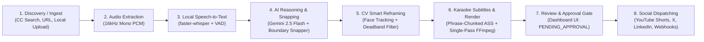
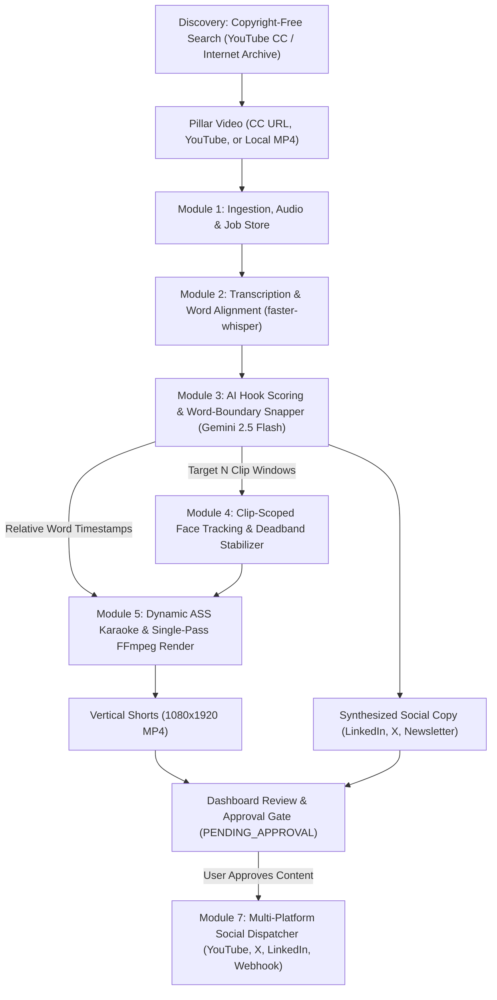

# PillarPrism 💎

> **Autonomous, zero-cost pillar content repurposing engine powered by Google Gemini 2.5 Flash, faster-whisper, MediaPipe computer vision, and FFmpeg.**

[](https://www.python.org/downloads/)
[](https://fastapi.tiangolo.com/)
[](https://ffmpeg.org/)
[](https://opensource.org/licenses/MIT)
[](tests/)

---

## 📖 Table of Contents
* [Overview](#-overview)
* [How It Works (The Full Flow)](#-how-it-works-the-full-flow)
* [Key Features](#-key-features)
* [Architecture Diagram](#-architecture-diagram)
* [Quick Start](#-quick-start)
  * [Prerequisites](#prerequisites)
  * [Installation](#installation)
  * [Environment Setup](#environment-setup)
* [Usage](#-usage)
  * [Option A: Web Dashboard](#option-a-web-dashboard)
  * [Option B: Headless CLI](#option-b-headless-cli)
* [REST API Overview](#-rest-api-overview)
* [Project Directory Structure](#-project-directory-structure)
* [Testing](#-testing)
* [Documentation Links](#-documentation-links)
* [License](#-license)

---

## 🌟 Overview

**PillarPrism** automates the entire digital content repurposing workflow. It ingests long-form videos (podcasts, webinars, interviews, conference talks) or discovers copyright-free / Creative Commons content, transcribes them with millisecond accuracy, uses Google Gemini to pinpoint viral hooks, reframes 16:9 widescreen footage into 9:16 vertical shorts using smart face tracking, burns dynamic word-pop karaoke subtitles, presents them in an interactive web dashboard for review and approval, and dispatches them across social media.

All heavy compute (transcription, face tracking, rendering, audio normalization) runs **100% locally** with zero cloud compute cost.

---

## 🔄 How It Works (The Full Flow)



1. **Discovery & Sourcing:** Search YouTube CC-BY and Internet Archive for copyright-free long-form videos, paste a video URL, or upload a local video file.
2. **Audio & Metadata Ingestion:** Normalizes audio to 16kHz mono WAV (`audio.wav`) via FFmpeg and extracts frame dimensions, FPS, and duration.
3. **Transcription & Word Alignment:** Uses `faster-whisper` with Silero VAD to produce word-level millisecond timestamps while filtering out background noise.
4. **AI Hook Scoring & Word Boundary Snapping:** Gemini 2.5 Flash evaluates engagement potential ($0\text{–}100$), generates multi-channel copy, and selects target clip windows. The boundary snapper maps approximate times to exact spoken word boundaries to eliminate awkward cuts.
5. **Computer Vision & Smart Reframing:** MediaPipe face tracking and OpenCV scene-cut detection center the speaker with a deadband stabilization filter, creating an optimal 9:16 vertical crop.
6. **Animated Subtitles & Single-Pass Render:** Generates styled `.ass` karaoke subtitles and executes a single-pass FFmpeg command combining dynamic cropping, Lanczos scaling to 1080x1920, subtitle burning, and EBU R128 audio normalization.
7. **Dashboard Review & Approval Gate:** The job enters `PENDING_APPROVAL`. Creators preview the rendered vertical shorts, review hook explanations, edit titles or social copy, and select approved clips.
8. **Multi-Platform Dispatcher:** Approved content is distributed with platform character compliance to YouTube Shorts, X/Twitter threads, LinkedIn, or custom webhooks.

---

## ⚡ Key Features

* **Zero Marginal Cost:** Uses Google Gemini 2.5 Flash free-tier API alongside local open-source models (`faster-whisper`, MediaPipe, FFmpeg).
* **🔍 Copyright-Free Discovery:** Built-in search for Creative Commons (CC-BY) and Public Domain content with automated attribution.
* **🎯 Configurable Clip Generation:** Request anywhere between $1$ to $10$ clips per long-form video.
* **✂️ Millisecond Boundary Snapping:** Snaps candidate cuts to exact spoken word start/end times so speakers are never cut off mid-sentence.
* **👤 Smart Face-Tracking Reframing:** Automatically centers active speakers using deadband-stabilized camera tracking that eliminates jitter.
* **🎤 Word-Pop Karaoke Subtitles:** High-contrast, phrase-chunked captions with highlighted active words burned directly into the video.
* **📝 Multi-Channel Copywriting:** Tailored LinkedIn insights, X/Twitter threads ($\le 275$ chars/tweet), and newsletter recaps.
* **✅ Review & Approval Gating:** Content is never published without human review.
* **🚀 Multi-Platform Social Dispatching:** One-click publishing to YouTube Shorts, X (Twitter), LinkedIn, and Webhooks.

---

## 🏗️ Architecture Diagram



---

## 🚀 Quick Start

### Prerequisites
* **Python 3.10+**
* **FFmpeg** installed and on your system `PATH` (run `ffmpeg -version` to verify)
* **Google Gemini API Key** (Free tier available at [Google AI Studio](https://aistudio.google.com/))

### Installation
```bash
# Clone the repository
git clone https://github.com/mdriyadmr968/PillarPrism.git
cd PillarPrism

# Create and activate a virtual environment
python -m venv venv
# On Windows:
.\venv\Scripts\activate
# On Linux / macOS:
source venv/bin/activate

# Install dependencies
pip install -r requirements.txt
```

### Environment Setup
Create a `.env` file in the project root:
```env
GEMINI_API_KEY=your_gemini_api_key_here
WHISPER_MODEL=base
WHISPER_DEVICE=cpu
WORKSPACE_DIR=workspace
```

---

## 💻 Usage

### Option A: Web Dashboard
Start the FastAPI server:
```bash
uvicorn backend.app.main:app --host 0.0.0.0 --port 8000 --reload
```
Open **`http://localhost:8000`** in your browser:
1. Search for copyright-free videos, paste a video URL, or click **Upload Local File**.
2. Select your target clip count ($1\text{–}10$) and click **Start Repurposing**.
3. Watch real-time pipeline execution progress.
4. When finished, review the 9:16 vertical shorts in the interactive video player.
5. Review hook scores, edit social copy, and click **Approve & Publish**.

### Option B: Headless CLI
PillarPrism includes a command-line interface for headless automation:

```bash
# 1. Search for copyright-free videos
python cli.py discover "Artificial Intelligence Lecture" --max 5

# 2. Process a video URL or local file (generate 3 shorts)
python cli.py process "https://www.youtube.com/watch?v=example" --clips 3

# 3. List all jobs in workspace
python cli.py list

# 4. Check detailed status of a specific job
python cli.py status <job_id>

# 5. Publish approved job to social platforms (or simulate)
python cli.py publish <job_id> --platforms youtube_shorts,twitter,linkedin --simulate
```

---

## 🔌 REST API Overview

| Method | Endpoint | Description |
| :--- | :--- | :--- |
| `GET` | `/api/config` | System status, Whisper model, and Gemini key status |
| `POST` | `/api/config/gemini-key` | Dynamically update and persist Gemini API key |
| `POST` | `/api/discovery/search` | Search YouTube CC and Internet Archive for CC videos |
| `POST` | `/api/jobs` | Ingest video from URL and trigger pipeline |
| `POST` | `/api/jobs/upload` | Multipart file upload for local video files |
| `GET` | `/api/jobs` | List all jobs in workspace |
| `GET` | `/api/jobs/{job_id}` | Get real-time job manifest, progress, and clips |
| `POST` | `/api/jobs/{job_id}/approve` | Save creator edits and approve selected clips |
| `POST` | `/api/jobs/{job_id}/publish` | Dispatch approved clips to social platforms |
| `POST` | `/api/jobs/{job_id}/retry` | Reset and re-run a failed job |
| `GET` | `/api/jobs/{job_id}/media/{path}` | Secure media streaming for preview players |

Full API documentation and schemas are available in [docs/API_REFERENCE.md](docs/API_REFERENCE.md) or via interactive Swagger docs at `http://localhost:8000/docs`.

---

## 📂 Project Directory Structure

```text
PillarPrism/
├── backend/
│   └── app/
│       ├── config.py                     # App settings & environment loader
│       ├── main.py                       # FastAPI application & REST endpoints
│       ├── pipeline.py                   # End-to-end PipelineOrchestrator
│       └── modules/
│           ├── ingestion/                # yt-dlp, FFmpeg audio & JobStore
│           ├── transcription/            # faster-whisper + Silero VAD
│           ├── intelligence/             # Gemini 2.5 Flash & Boundary Snapper
│           ├── video_processing/         # Face tracking, deadband & FFmpeg render
│           ├── subtitles/                # Phrase-chunked karaoke .ASS generator
│           ├── discovery/                # CC video finder (YouTube CC / Archive)
│           └── publishing/               # Social dispatcher (YT, Twitter, LinkedIn)
├── docs/
│   ├── ARCHITECTURE_AND_FLOW.md          # In-depth architectural breakdown & flow
│   ├── API_REFERENCE.md                  # Complete REST API specifications & schemas
│   └── USER_GUIDE.md                     # Step-by-step user tutorials & tips
├── frontend/
│   └── dist/
│       └── index.html                    # Responsive single-page dashboard UI
├── tests/                                # 28 comprehensive unit & integration tests
├── cli.py                                # Headless CLI for terminal operation
├── requirements.txt                      # Python dependencies
└── README.md
```

---

## 🧪 Testing

PillarPrism includes 28 unit and integration tests covering every module:

```bash
pytest -v
```

All tests execute offline using synthetic media fixtures and fallback intelligence mock synthesis when an API key is not present.

---

## 📚 Documentation Links

* [Complete Architecture & Flow](docs/ARCHITECTURE_AND_FLOW.md)
* [REST API Reference](docs/API_REFERENCE.md)
* [User Guide & Tutorials](docs/USER_GUIDE.md)
* [Implementation Plan](IMPLEMENTATION_PLAN.md)

---

## 📄 License

This project is licensed under the [MIT License](LICENSE).
