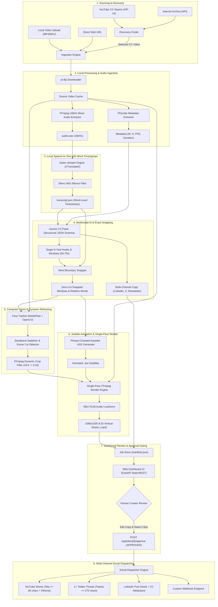
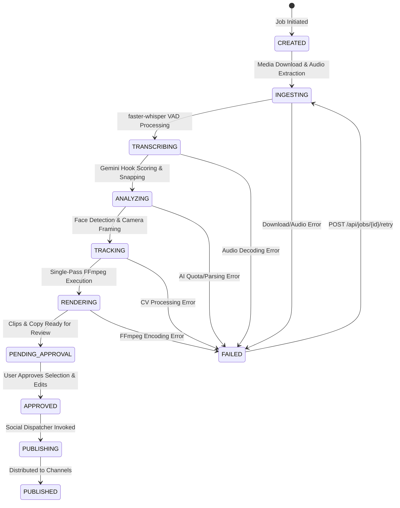

# PillarPrism — System Architecture & Complete Flow

PillarPrism is an autonomous, local-first digital video repurposing platform designed to transform long-form pillar content (podcasts, lectures, webinars, interviews) into high-retention 9:16 vertical shorts, social threads, and newsletters.

---

## 1. High-Level Architecture

The architecture combines **cloud-based multimodal reasoning** (via Google Gemini 2.5 Flash free tier) with **local-first processing engines** (`faster-whisper`, `FFmpeg`, `MediaPipe`/`OpenCV`) to deliver zero marginal compute cost and sub-second cut precision.



---

## 2. End-to-End Pipeline Stages

### Stage 1: Discovery & Ingestion
* **Discovery:** The creator can search by keyword for Creative Commons (CC-BY) and Public Domain content across YouTube and Internet Archive. Candidates display duration, license type, attribution text, and preview links.
* **Direct Input:** Alternatively, direct URLs (YouTube, Vimeo, direct MP4) or local video files can be uploaded directly via browser multipart upload.
* **Extraction:**
  * FFprobe extracts video resolution, framerate, duration, and aspect ratio.
  * FFmpeg extracts a 16kHz mono 16-bit PCM WAV (`audio.wav`) optimal for Whisper transcription.
* **State Management:** A dedicated folder `workspace/{job_id}/` is created with an atomic [`manifest.json`](file:///c:/Projects/PillarPrism/backend/app/modules/ingestion/job_store.py) tracking pipeline progress, clip counts, status, and error logs.

---

### Stage 2: Transcription & Word-Level Alignment
* Powered by `faster-whisper` (CTranslate2 reimplementation of OpenAI Whisper) running locally on CPU or CUDA.
* **Millisecond Precision:** Extracts millisecond-accurate timestamps for every word uttered:
  $$\text{WordTimestamp} = (\text{word}, \text{start\_sec}, \text{end\_sec}, \text{probability})$$
* **Silero VAD Filter:** Voice Activity Detection suppresses silence hallucinations, background music artifacts, and non-speech noise.
* Results are cached to `workspace/{job_id}/transcript.json` to prevent re-transcription if downstream stages are re-run.

---

### Stage 3: Gemini 2.5 Flash Multimodal Intelligence & Boundary Snapping
* **Prompt Engineering & Schema:** Formats the complete transcript with timestamps and episode metadata, sending it to Gemini 2.5 Flash with strict Pydantic JSON schemas.
* **Viral Hook Scoring:** Gemini evaluates content retention, scoring candidates on a scale of $0\text{–}100$, identifying:
  * An attention-grabbing hook in the first $3\text{–}5$ seconds.
  * A coherent narrative arc within a $30\text{–}75$ second duration.
  * A memorable punchline or closing payoff.
* **Configurable Clip Count:** Respects the user's requested clip count ($1\text{–}10$ clips per episode).
* **Word Boundary Snapper:** Gemini provides approximate start/end seconds. The boundary snapper maps these to the exact nearest word boundaries in the transcript:
  $$t_{\text{start, snapped}} = \text{word}[i].\text{start}, \quad t_{\text{end, snapped}} = \text{word}[j].\text{end}$$
  This prevents cutting speakers off mid-syllable.
* **Relative Timestamp Re-indexing:** Words within the selected window are re-indexed from $t = 0.0\text{s}$ for subtitle synchronization.
* **Cross-Channel Copy Generation:** Gemini generates a tailored LinkedIn post, an X/Twitter multi-tweet thread, and a newsletter recap with source attribution.

---

### Stage 4: Computer Vision & Smart 9:16 Re-framing
* **Face Tracking:** Runs MediaPipe Face Detection (with OpenCV Haar Cascade fallback) across sample frames of the selected clip.
* **Deadband Stabilization:**
  * To avoid nauseating micro-pans when the speaker moves slightly, a deadband threshold (12% of screen width) is applied:
  $$\Delta x = |x_{\text{target}} - x_{\text{current}}|$$
  $$\text{If } \Delta x < \text{threshold}, \quad x_{\text{smoothed}} = x_{\text{current}}$$
  $$\text{Else } \quad x_{\text{smoothed}} = x_{\text{current}} + \alpha \cdot (x_{\text{target}} - x_{\text{current}})$$
* **Scene Cut Detection:** Histogram correlation detects camera cuts; on a cut, smoothing resets instantly to avoid sweeping pans across scene transitions.
* **Crop Formulation:** Outputs an FFmpeg `crop=W:H:X:Y` expression or an automated `sendcmd` panning script.

---

### Stage 5: Karaoke Subtitle Generation & Single-Pass Render Engine
* **Phrase Chunking:** Groups words into natural rhythmic spoken phrases ($3\text{–}6$ words per subtitle event).
* **Advanced SubStation Alpha (`.ass`) Styling:**
  * Resolution: `PlayResX: 1080`, `PlayResY: 1920`.
  * Font: High-legibility sans-serif (`Montserrat` / `Arial Black`, bold, font size 68).
  * Color: Primary white (`&H00FFFFFF&`), yellow word-pop active highlight (`&H0000FFFF&`), drop shadow and border outline for contrast over any background.
* **Single-Pass FFmpeg Pipeline:**
  FFmpeg combines video slicing, dynamic 9:16 cropping, Lanczos scaling, subtitle burning, and audio loudness normalization in a single unified command:
  ```bash
  ffmpeg -y -ss {start_sec} -i {source_video} -t {duration} \
    -vf "crop={w}:{h}:{x}:{y},scale=1080:1920:flags=lanczos,ass={subtitle_path}" \
    -af "loudnorm=I=-16:TP=-1.5:LRA=11" \
    -c:v libx264 -preset veryfast -crf 20 -c:a aac -b:a 192k \
    {output_clip_path}
  ```
* Slicing with `-ss` before `-i` enables keyframe fast-seeking, while `-t {duration}` ensures frame-accurate duration without drift.

---

### Stage 6: Dashboard Review & Approval Gating
* **Gated Workflow:** Newly generated jobs transition to `JobStatus.COMPLETED` with `approval_status = "PENDING_APPROVAL"`.
* **Creator Control:** Content is **never** dispatched automatically without explicit human consent:
  * Creators preview rendered 9:16 shorts in the browser.
  * Inspect hook scores, virality explanations, and subtitle synchronization.
  * Edit generated titles, LinkedIn copy, or Twitter threads directly in the web UI.
  * Select which clips to publish (or discard weak candidates).
  * Click **Approve & Publish**.

---

### Stage 7: Multi-Platform Social Dispatcher
* **Platform Adapters:**
  * **YouTube Shorts:** Formats titles with mandatory `#Shorts` tag, strictly enforcing YouTube's $\le 100$ character limit ($\le 85$ characters base title).
  * **X / Twitter:** Splits copy into an ordered thread, enforcing Twitter's $\le 275$ character limit per tweet.
  * **LinkedIn:** Formats long-form copy with bullet points, takeaways, and automated CC-BY attribution.
  * **Webhooks:** Emits JSON payloads containing clip metadata, video URLs, and social copy to Zapier, Make, or custom API endpoints.
* **Simulation Mode:** Allows dry-run testing without consuming platform API quotas or posting live.

---

## 3. Job State Machine



---

## 4. Directory Structure & Storage Layout

Each processing job creates an isolated workspace folder with full provenance:

```text
workspace/
└── <job_id>/
    ├── manifest.json            # Complete job manifest, status, clips, copy & logs
    ├── source.mp4               # Downloaded or uploaded raw pillar video
    ├── audio.wav                # 16kHz mono PCM audio track
    ├── transcript.json          # Word-level timestamped transcription
    ├── analysis.json            # Gemini hook detection, boundary snapping & copy
    ├── clips/
    │   ├── clip_01.mp4          # Final 1080x1920 vertical short with burned subtitles
    │   ├── clip_01.ass          # Advanced SubStation Alpha karaoke subtitle file
    │   ├── clip_02.mp4
    │   └── clip_02.ass
    └── publishing/              # Dispatch logs & receipt records
```
